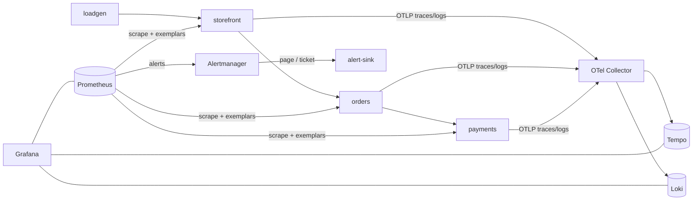

# slo-observability-stack

[](https://github.com/gastonhp1/slo-observability-stack/actions/workflows/ci.yml)

**SLOs as code on an OpenTelemetry + Prometheus + Grafana stack, with burn-rate
alerting that is unit-tested and proven end to end in CI.**

Three small instrumented services, an observability backend (Prometheus, Loki,
Tempo, Alertmanager, Grafana) and the part most demos skip: the SLO
definitions, the alerting math, the routing policy, runbooks for every alert,
and a test that injects a real failure and checks the right person gets paged.

```
make up                         # stack + traffic, Grafana on http://localhost:3000
scripts/chaos.sh errors payments 0.6
# ~30 seconds later: CheckoutAvailability pages, the ticket is inhibited,
# the exemplar on the latency graph opens the failing trace, the trace opens its logs.
```

## What this demonstrates

| Area | What is here |
|---|---|
| **SLO engineering** | 4 SLOs (availability + latency, user-facing + dependency) defined in [Sloth-format specs](slo/specs). A generator, [`slogen`](tools/slogen), emits multiwindow multi-burn-rate rules (Google SRE Workbook). Error budget policy in [docs/slo-policy.md](docs/slo-policy.md). |
| **Alerting that is tested** | [`promtool` unit tests](observability/prometheus/tests) prove: fast burn pages, slow burn only tickets, 4xx never burns budget, a dead service pages even with no error metrics. Alertmanager routing is tested with `amtool`. |
| **Alert design** | page vs ticket routing, inhibition (one incident → one page), dependency SLOs that never page, symptom-less failure coverage (`ShopTargetDown`, `SLIMetricsMissing`). |
| **Observability** | OpenTelemetry traces and logs over OTLP; RED metrics with **exemplars**; Grafana datasources cross-linked metric → trace → logs → metric. |
| **Operations** | A [runbook per alert](docs/runbooks), [chaos experiments](docs/chaos.md) written as hypotheses, a [game-day postmortem](docs/postmortems/2026-10-29-payments-5xx.md). |
| **CI** | Lint, unit tests, generated-code drift checks, config validation with the real binaries (`promtool`, `amtool`, `otelcol validate`, `loki -verify-config`) and a **full e2e** on every push. |

## The end-to-end test

[`tests/e2e/run.sh`](tests/e2e/run.sh) runs in GitHub Actions against the real
`docker compose` stack:

1. All components up, 3 targets scraped, every Prometheus rule healthy.
2. SLO recording rules have data; nothing firing at baseline.
3. Inject 60% 5xx into **payments**, two hops away from the user.
4. Assert `CheckoutAvailability` **page** fires, Alertmanager routes it to the
   `pager` receiver, and the webhook receives it with its runbook link.
5. Assert the incident is visible in every signal: exemplars with `trace_id`,
   a Tempo trace spanning storefront → payments with an error, Loki error logs
   carrying the `trace_id`.
6. Assert Grafana datasources are healthy and dashboards are provisioned.
7. Clear the fault, checkout recovers.

## Architecture



Design decisions and the production differences are in
[docs/architecture.md](docs/architecture.md).

| Component | Version |
|---|---|
| Prometheus | 3.15.1 |
| Alertmanager | 0.34.2 |
| Grafana | 13.3.0 |
| Loki | 3.7.9 |
| Tempo | 3.1.1 |
| OpenTelemetry Collector (contrib) | 0.164.0 |
| Python / FastAPI / OTel SDK | 3.13 / 0.162 / 1.45 |

## SLOs

| SLO | Objective | Alerts |
|---|---|---|
| `storefront-checkout-availability` | 99.9% non-5xx | page + ticket |
| `storefront-checkout-latency` | 99% < 500ms | page + ticket |
| `storefront-catalog-availability` | 99.9% non-5xx | page + ticket |
| `payments-capture-availability` | 99.95% non-5xx | ticket only (dependency) |

| Severity | Windows | Burn rate | Budget spent when it fires |
|---|---|---|---|
| page | 5m and 1h | 14.4x | 2% |
| page | 30m and 6h | 6x | 5% |
| ticket | 2h and 1d | 3x | 10% |
| ticket | 6h and 3d | 1x | 10% |

Adding an SLO is a spec change:

```yaml
# slo/specs/storefront.yml
  - name: checkout-availability
    objective: 99.9
    sli:
      events:
        error_query: sum(rate(http_requests_total{service="storefront", route="/checkout", code=~"5.."}[{{.window}}]))
        total_query: sum(rate(http_requests_total{service="storefront", route="/checkout"}[{{.window}}]))
    alerting:
      name: CheckoutAvailability
      annotations:
        runbook_url: https://github.com/gastonhp1/slo-observability-stack/blob/main/docs/runbooks/checkout-availability.md
```

```bash
make slo     # regenerate observability/prometheus/rules/slo/*.yml
make check   # lint + unit tests + drift + promtool
```

## Running it

Requirements: Docker with Compose v2, `make`, `curl`, `jq`. Python 3.12+ only
for development.

```bash
make up            # build and start; waits for health checks
make e2e           # the CI scenario against your local stack
make chaos-errors  # 30% 5xx in payments
make chaos-latency # +800ms on half of payments calls
make chaos-clear
make down          # stop and delete volumes
```

| URL | What |
|---|---|
| http://localhost:3000 | Grafana (anonymous viewer; `admin`/`admin` to edit). Home: *SLO overview* |
| http://localhost:9090 | Prometheus (rules, alerts, exemplars) |
| http://localhost:9093 | Alertmanager |
| http://localhost:8085/alerts | Notifications received by the pager/ticket stand-in |
| http://localhost:8080/docs | Storefront API |

## Repository layout

```
services/                  demo services (FastAPI + OpenTelemetry), loadgen, alert-sink
slo/specs/                 SLO definitions (source of truth)
tools/slogen/              spec -> Prometheus rules generator, with tests
tools/dashboards/          Grafana dashboards as code
observability/
  prometheus/              config, rules (generated SLO + hand-written platform), promtool tests
  alertmanager/            routing, inhibition
  otel-collector/ loki/ tempo/ grafana/
tests/e2e/                 end-to-end scenario run in CI
scripts/chaos.sh           fault injection helper
docs/                      SLO policy, runbooks, chaos experiments, postmortem, architecture
```

## Roadmap

- [ ] Deploy on Kubernetes with the kube-prometheus-stack and Grafana Helm charts (kind in CI, AKS via GitOps).
- [ ] Long-term storage with Mimir or Thanos, so the 30d SLO window survives restarts.
- [ ] Traffic-weighted period SLI (today the 30d value averages the 5m ratio over time).
- [ ] Synthetic probes (blackbox exporter) as a second SLI source for the catalog.
- [ ] `sloth generate` as an alternative generator in CI, to prove spec compatibility.

## License

[MIT](LICENSE)
