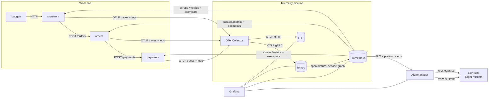

# Architecture



## Signals and why each one travels the way it does

| Signal | Path | Why |
|---|---|---|
| Metrics | Prometheus **pulls** `/metrics` from each service | The SLO rules depend on exact series names; the Prometheus client gives full control over them. Pull also gives a free liveness signal (`up`), which `ShopTargetDown` relies on. |
| Traces | OTLP push → Collector → Tempo | Standard OpenTelemetry. The collector decouples services from the backend (batching, memory limits, one place to change exporters). |
| Logs | OTLP push → Collector → Loki native OTLP endpoint | Logs keep `trace_id`/`span_id` as structured metadata, so Grafana links a log line to its trace without regex parsing. Services also log JSON to stdout for `docker compose logs`. |
| Exemplars | Attached to the latency histogram (OpenMetrics) | Click a point on the p99 graph, land on the exact slow trace. |

## Correlation, end to end

```
latency p99 spike ──exemplar trace_id──► Tempo trace ──trace_id──► Loki logs of that request
       ▲                                     │
       └──────── tracesToMetrics ◄───────────┘
```

Configured in [`datasources.yaml`](../observability/grafana/provisioning/datasources/datasources.yaml):
`exemplarTraceIdDestinations` (Prometheus → Tempo), `tracesToLogsV2` (Tempo →
Loki), `derivedFields` on `trace_id` (Loki → Tempo), `tracesToMetrics` (Tempo →
Prometheus).

## SLOs as code

```
slo/specs/*.yml  ──slogen──►  observability/prometheus/rules/slo/*.yml  ──►  Prometheus
 (Sloth prometheus/v1)          (recording + alerting rules, committed)
                                         │
                       promtool test rules (unit tests in CI)
```

* Specs are the source of truth; generated rules are committed so reviewers see
  the PromQL that will actually run, and CI fails on drift.
* `slogen` emits, per SLO: error ratios for 5m…3d windows plus the 30d period,
  objective/budget/burn-rate metadata for dashboards, and the page/ticket
  multiwindow multi-burn-rate alerts. See [slo-policy.md](slo-policy.md).
* Why a custom generator instead of [Sloth](https://github.com/slok/sloth): the
  logic is ~200 lines and fully unit-tested here, and the specs keep Sloth's
  format, so switching to `sloth generate` later is a change in one CI step.

## The services

One image, five roles (`storefront`, `orders`, `payments`, `loadgen`,
`alert-sink`). FastAPI + OpenTelemetry SDK; the OTel ASGI middleware wraps an
observability middleware that records RED metrics with the route **template**
(`/products/{product_id}`) to keep label cardinality bounded.

Fault injection is a router dependency, not middleware, so injected errors are
attributed to the real route and burn the right SLO.

## Production differences (deliberate simplifications)

| Here | In production |
|---|---|
| Single-binary Tempo and Loki, local disk | Object storage (Azure Blob / GCS / S3), microservices or the Helm charts' simple scalable mode |
| One Prometheus, 10s scrape | Prometheus/agent per cluster, remote write to Mimir/Thanos for long retention (30d SLO windows need ≥ 30d of data) |
| alert-sink webhook | PagerDuty / Opsgenie for `page`, Jira/GitHub issues for `ticket` |
| Anonymous Grafana viewer | SSO (Entra ID / Google), folders per team |
| `/admin/faults` open by default | Disabled in prod builds, or behind auth + network policy |
